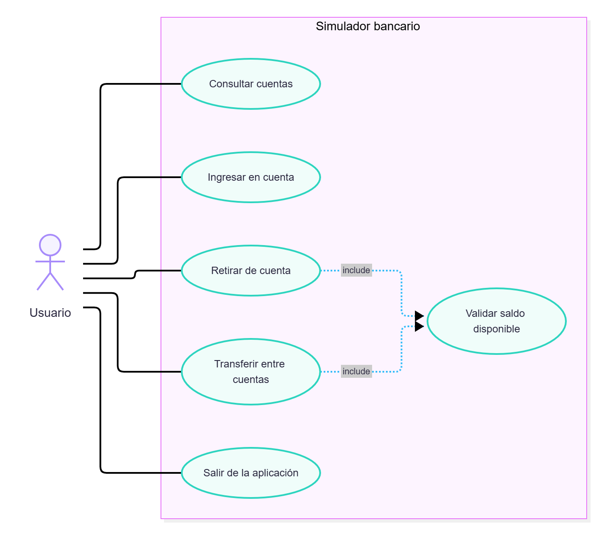
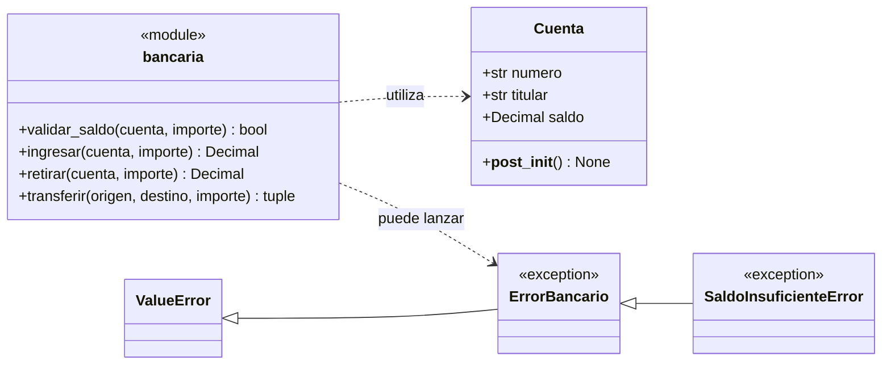

# Simulador de transferencias bancarias

Aplicación de consola en Python que permite ingresar y retirar dinero, transferir
entre dos cuentas y validar que una cuenta tenga saldo suficiente.

### Diagrama de casos de uso

El usuario puede consultar las cuentas y realizar las tres operaciones
bancarias. Retirar y transferir incluyen la validación de saldo antes de
modificar las cuentas.

A continuación se presenta el diagrama de casos de uso.



### Diagrama de clases

El siguiente diagrama muestra las clases principales y su relación con las
funciones del módulo `bancaria.py`:



## Preparar el entorno virtual desde Git Bash

El proyecto utiliza Python 3.12. Antes de crear el entorno, comprueba que esa
versión está instalada en Windows:

```bash
py -3.12 --version
```

El resultado debe comenzar por `Python 3.12`. Un entorno virtual no instala una
versión nueva de Python, sino que se crea a partir de una versión ya instalada.
Abre Git Bash en la raíz del proyecto y crea `pruebas_env` explícitamente con
Python 3.12:

```bash
py -3.12 -m venv pruebas_env
```

Activa el entorno desde Git Bash:

```bash
source pruebas_env/Scripts/activate
```

Cuando el entorno esté activo, su nombre aparecerá al principio de la línea de
comandos como `(pruebas_env)`. Comprueba que utiliza el intérprete correcto e
instala las dependencias del proyecto:

```bash
python --version
python -m pip install --upgrade pip
python -m pip install -r requirements.txt
```

El comando `python --version` debe mostrar Python 3.12. Esto evita ejecutar la
aplicación accidentalmente con otra instalación, como una versión antigua de
Python incluida en Anaconda.

Todos los comandos siguientes deben ejecutarse en esa misma terminal de Git
Bash. Para salir del entorno virtual cuando termines, utiliza:

```bash
deactivate
```

## Ejecutar la aplicación

```bash
python main.py
```

La aplicación crea dos cuentas de ejemplo (`ES001` y `ES002`) cuyos saldos se
mantienen mientras el programa está en ejecución.

## Ejecutar las pruebas

Con `pruebas_env` activado:

```bash
python -m pytest -v
```

## Integración continua con GitHub Actions

El workflow `.github/workflows/tests.yml` ejecuta automáticamente las pruebas
en un runner de Ubuntu con Python 3.12 cuando se realiza un `push` o se crea o
actualiza un `pull request`.

Después de subir el proyecto a GitHub, el resultado puede consultarse en la
pestaña **Actions** del repositorio. Si alguna prueba falla, el job también
fallará y GitHub mostrará el detalle de pytest en el registro de ejecución.

La lógica reutilizable se encuentra en `bancaria.py`: `ingresar`, `retirar`,
`transferir` y `validar_saldo`. Los importes se representan con `Decimal` para
evitar errores de redondeo propios de los números en coma flotante.
